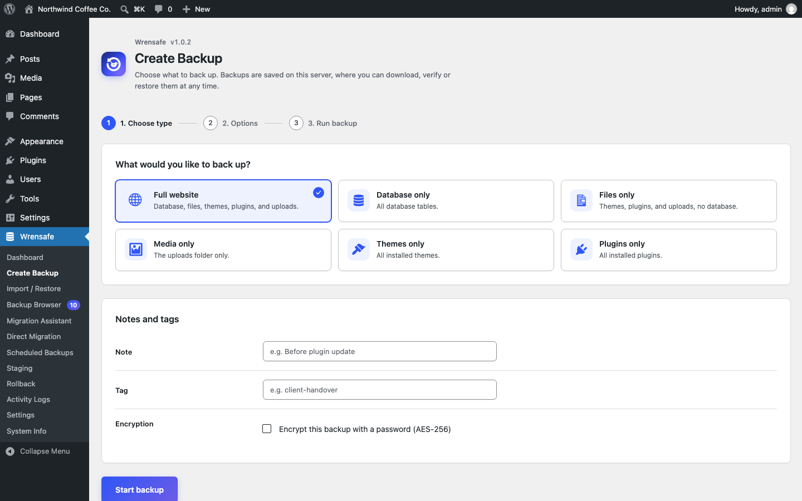
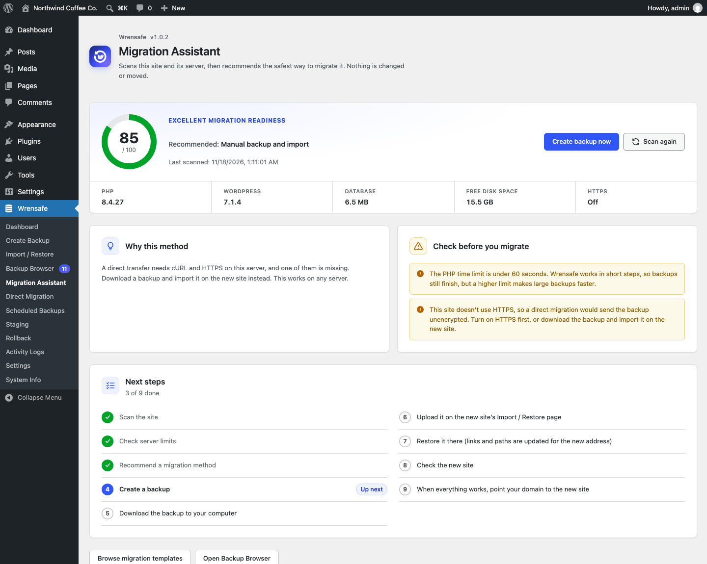
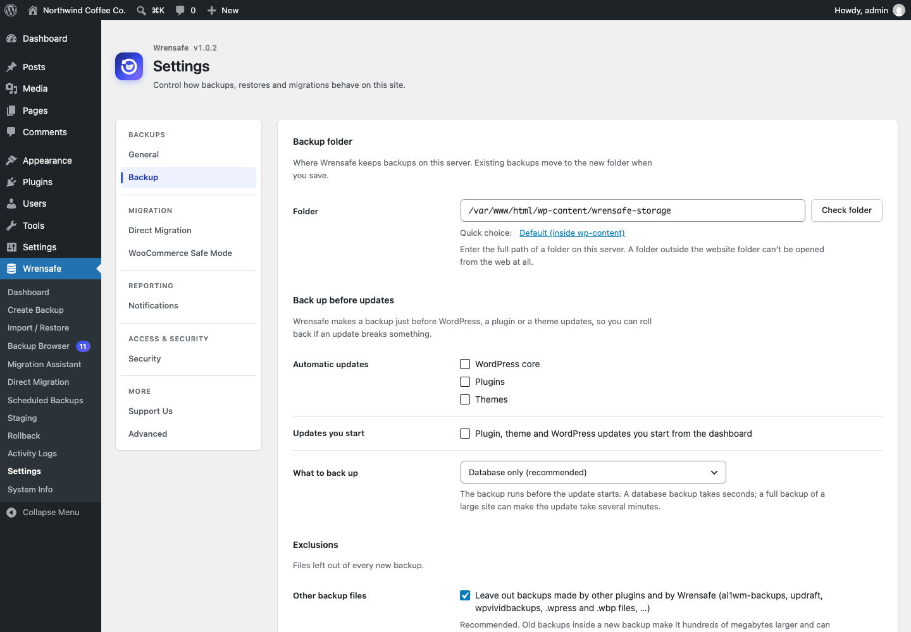
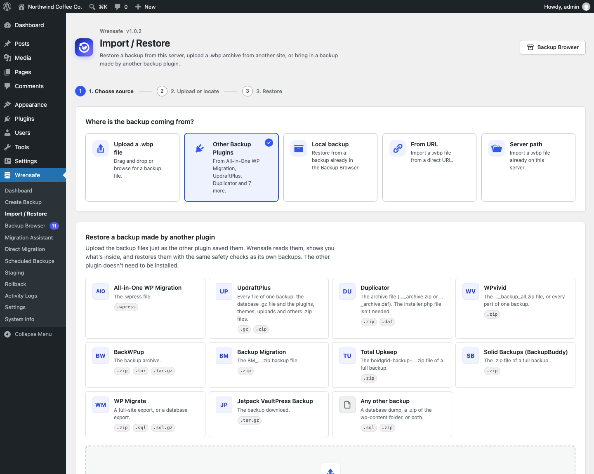

# Wrensafe – WP Backup, Restore & Migration

Back up, restore and migrate WordPress with checks at every step. Nothing on your site changes until you've reviewed it.

**Free · GPL v2 or later · WordPress 6.0+ · PHP 7.4+**

> Wrensafe is waiting for approval in the WordPress.org plugin directory. Until then, download it from this page.

## Download and install

1. Download **`wrensafe-<version>.zip`** from the [latest release](https://github.com/oyegohar/wrensafe-plugin/releases/latest).
   Use the file under **Assets**, not GitHub's green **Code → Download ZIP** button: that one has a different folder name and won't update properly later.
2. In WordPress go to **Plugins → Add New Plugin → Upload Plugin**, choose the zip, click **Install Now**, then **Activate**.
3. Open **Wrensafe** in the admin menu and click **Create backup**.

**Updating:** install a newer zip the same way; WordPress replaces the old version and your settings and backups stay. Once Wrensafe is on WordPress.org, updates arrive in your dashboard automatically.

## Screenshots

<table>
<tr>
<td width="50%"> <b>Dashboard</b>: see at a glance whether your site is backed up.</td>
<td width="50%"> <b>Create a backup</b>: the whole site or just what you need, optionally encrypted.</td>
</tr>
<tr>
<td> <b>Live progress</b>, step by step; cancel safely at any time.</td>
<td> <b>Backup Browser</b>: restore, download, verify, lock, tag and delete.</td>
</tr>
<tr>
<td> <b>Review before you restore</b>: what's inside and what will change.</td>
<td> <b>Integrity check</b>: archive, database and every file's checksum.</td>
</tr>
<tr>
<td> <b>Automatic backups</b> at the time you choose, keeping the newest copies.</td>
<td> <b>Migration Assistant</b>: readiness score, recommended method, next steps.</td>
</tr>
<tr>
<td> <b>Settings</b> grouped by task: backup folder, exclusions, notifications.</td>
<td> <b>Restore backups made by 10 other plugins</b>, just as they saved them.</td>
</tr>
</table>

## Features

### Back up
- Full site, or only the database, files, media, themes or plugins.
- One `.wbp` file per backup, with a manifest and checksums.
- Optional AES-256 encryption per backup; the password is never stored.
- Notes and tags on backups.
- Automatic backups every day, week or month at a set time, keeping the newest copies.
- A backup before WordPress, plugin and theme updates.
- No size limit: backups run in short steps, so they finish even where PHP stops scripts after 30 seconds. Interrupted uploads and downloads resume.
- Smart exclusions: other plugins' backup files and cache folders are skipped by default; add your own folders and file types.
- Choose where backups are kept, including a folder outside the website.
- `wp-config.php` and the site's security keys are never put in a backup.

### Restore safely
- Review before you restore: where the backup comes from, what's inside, what will change.
- Restore everything, or only the database, files, media, themes, plugins, or selected tables.
- Every file is checked first, and a rollback point is saved automatically so a restore can be undone.
- The database switches over in one step; visitors see a maintenance page meanwhile and you stay logged in.
- Plugin safety: a plugin that would break the restored site is turned off, and you're told which one and why.
- WooCommerce Safe Mode keeps new orders, customers and stock.
- Restore backups made by **All-in-One WP Migration, UpdraftPlus, Duplicator, WPvivid, BackWPup, Backup Migration, Total Upkeep, Solid Backups, WP Migrate and Jetpack VaultPress Backup**, or a plain `.sql` / `.zip` / `.tar`.

### Migrate
- Move a site to a new domain or server; URLs and paths are rewritten safely, including serialized and page-builder data.
- Direct Migration: send a backup straight to another site with a one-time key.
- Migration Assistant: readiness score, server checks, recommended method and a checklist.
- Staging: a private copy with its own tables and keys, optional password protection, push to live.

### Stay informed
- Dashboard with protection status, backups, schedules and migration readiness.
- Activity Logs and a one-click debug bundle for support.
- Email when a backup or restore fails (and, if you like, when one succeeds).
- A security scan: core files checked against WordPress.org, PHP in uploads, hidden encoded code, unsafe permissions.
- Fully translatable, with right-to-left language support.

## Privacy

Backups stay on your server. Nothing is sent to Wrensafe or anyone else, and there is no tracking. Data leaves your site only when an administrator starts one of these: the core-file check (WordPress.org checksums API), Import from URL, or Direct Migration to another site.

## Found a problem?

[Open an issue](https://github.com/oyegohar/wrensafe-plugin/issues/new/choose). It helps a lot to attach the debug bundle from **Wrensafe → Activity Logs → Export debug bundle** (passwords and keys are never included).

## Licence

Wrensafe is free software under the [GNU General Public License v2 or later](LICENSE), the same licence as WordPress. Copyright © 2026 [Husnain Gohar](https://profiles.wordpress.org/oyegohar/).

The name **Wrensafe**, the logo and the artwork in `.wordpress-org/` identify this project. If you publish a modified version, please give it your own name and branding.
