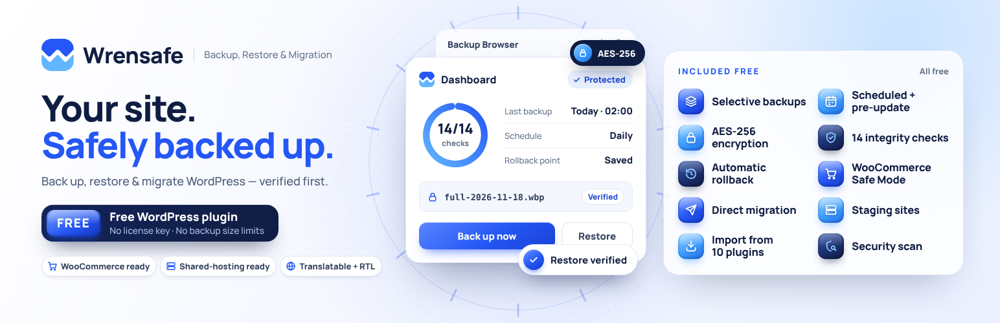

# Wrensafe – Backup, Restore & Migration

Back up, restore and migrate WordPress with checks at every step. Nothing on your site changes until you've reviewed it.

**Free · GPL v2 or later · WordPress 6.2+ · PHP 7.4+**

Wrensafe is in the WordPress.org plugin directory: **[wordpress.org/plugins/wrensafe](https://wordpress.org/plugins/wrensafe/)**. This repository has the same code for every release.

## Download and install

**From WordPress (recommended):** go to **Plugins → Add New Plugin**, search for **Wrensafe**, click **Install Now**, then **Activate**. Updates then arrive in your dashboard like any other plugin.

**From this page:**

1. Download **`wrensafe-<version>.zip`** from the **Assets** of the [latest release](https://github.com/oyegohar/wrensafe-plugin/releases/latest).
   Don't use **Source code (zip)** or the green **Code → Download ZIP** button: those are GitHub's copies of the repository, not the plugin package, and WordPress won't install them.
2. In WordPress go to **Plugins → Add New Plugin → Upload Plugin**, choose the zip, click **Install Now**, then **Activate**.
3. Open **Wrensafe** in the admin menu and click **Create backup**.

**Updating a zip install:** upload the newer `wrensafe-<version>.zip` the same way and choose **Replace current with uploaded**. Your settings and backups stay. After that, WordPress offers new versions from WordPress.org automatically.

**Installed twice?** An older "Source code" download installed Wrensafe in a folder such as `wrensafe-plugin-1.1.0`, so later uploads were added as a second plugin. Fix it once: upload `wrensafe-<version>.zip` from the Assets, activate it, then deactivate and delete the other Wrensafe copies on the Plugins screen. Settings and backups are kept (Wrensafe 1.1.2 and later never remove shared data while another copy is installed; for older copies, check that **Settings → Advanced → Uninstall** is off before deleting them).

## Screenshots

<table>
<tr>
<td width="50%">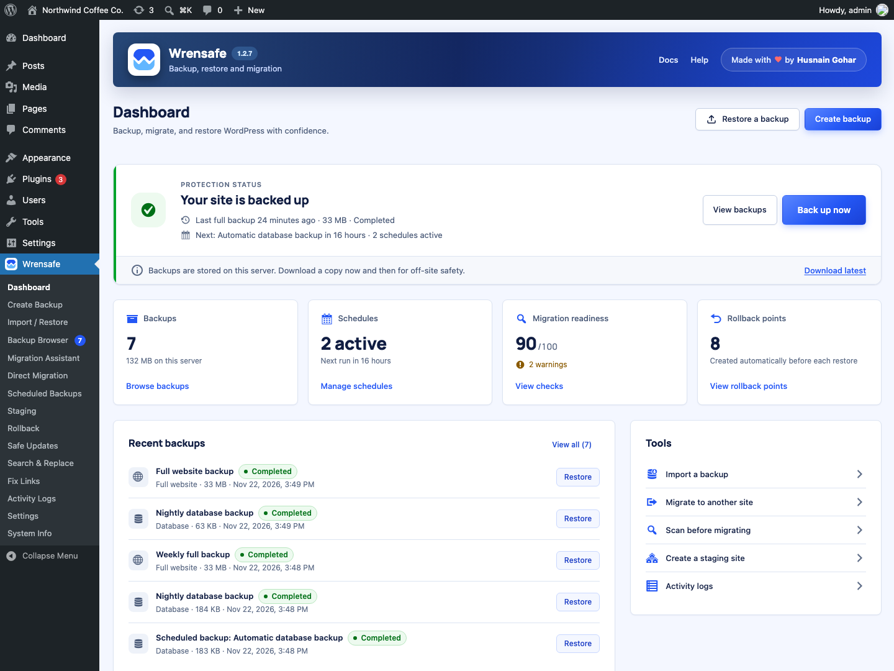 <b>Dashboard</b>: see at a glance whether your site is backed up.</td>
<td width="50%"> <b>Create a backup</b>: the whole site or just what you need, optionally encrypted.</td>
</tr>
<tr>
<td>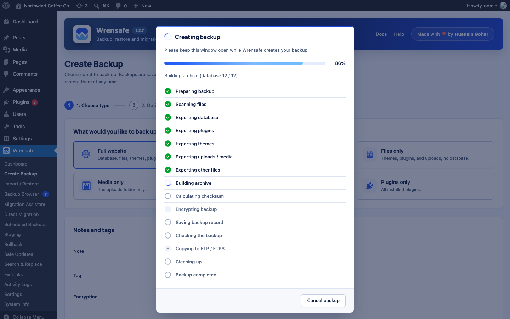 <b>Live progress</b>, step by step; cancel safely at any time.</td>
<td>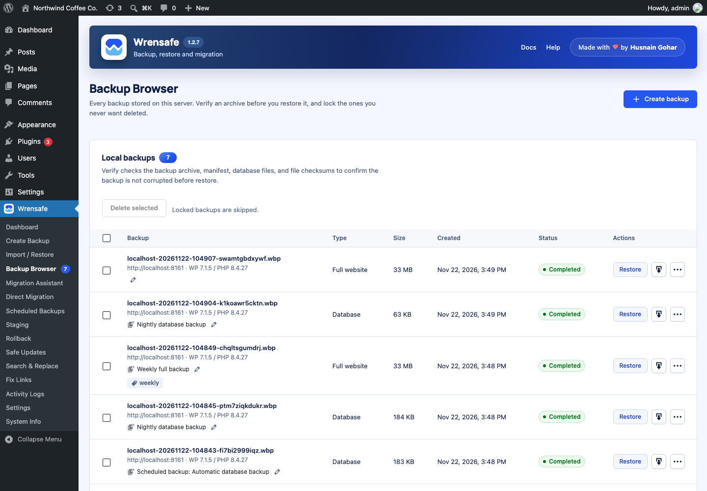 <b>Backup Browser</b>: restore, download, verify, lock, tag and delete.</td>
</tr>
<tr>
<td>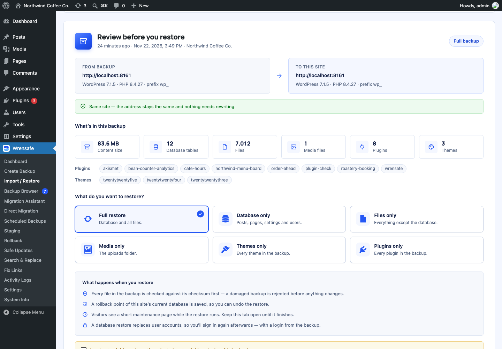 <b>Review before you restore</b>: what's inside and what will change.</td>
<td>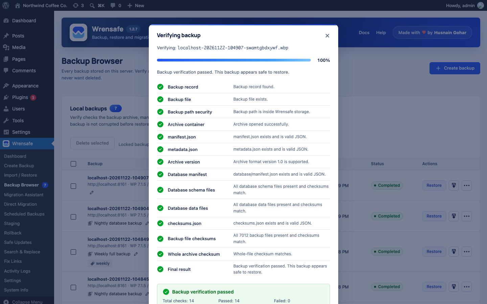 <b>Integrity check</b>: archive, database and every file's checksum.</td>
</tr>
<tr>
<td>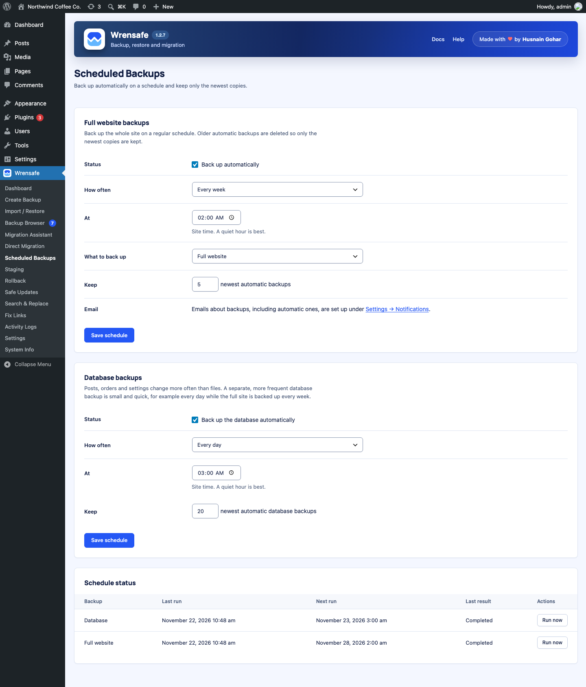 <b>Two schedules</b>: the whole site weekly, the database every day.</td>
<td> <b>Migration Assistant</b>: readiness score, recommended method, next steps.</td>
</tr>
<tr>
<td> <b>Settings</b> grouped by task: backup folder, exclusions, updates, notifications.</td>
<td> <b>Restore backups made by 10 other plugins</b>, just as they saved them.</td>
</tr>
<tr>
<td>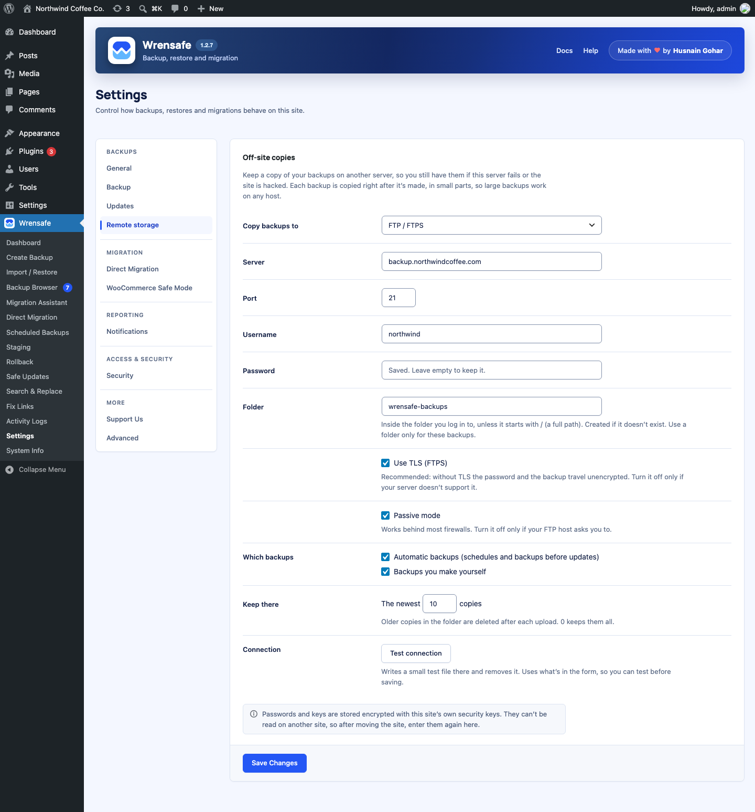 <b>Off-site copies</b> to FTP/FTPS or S3-compatible storage, with a connection test.</td>
<td>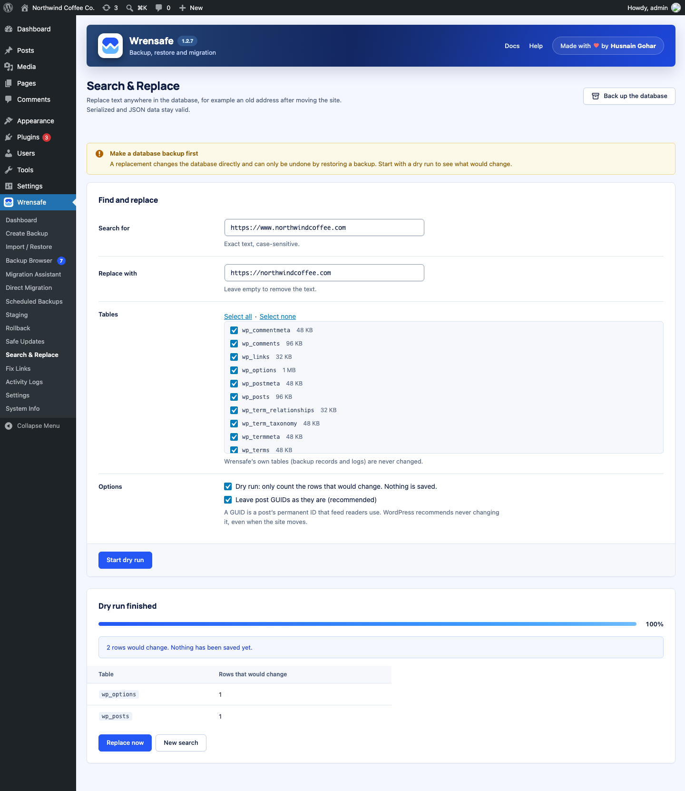 <b>Search &amp; Replace</b>: a dry run shows what would change before anything is saved.</td>
</tr>
<tr>
<td>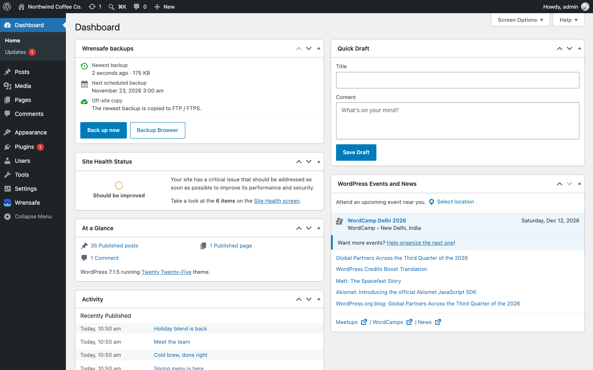 <b>Dashboard widget</b>: newest backup, next run, off-site copy and Back up now.</td>
<td>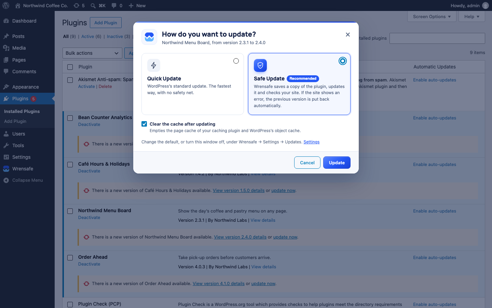 <b>Quick or Safe Update</b>: Safe Update checks your site and rolls a breaking update back.</td>
</tr>
<tr>
<td>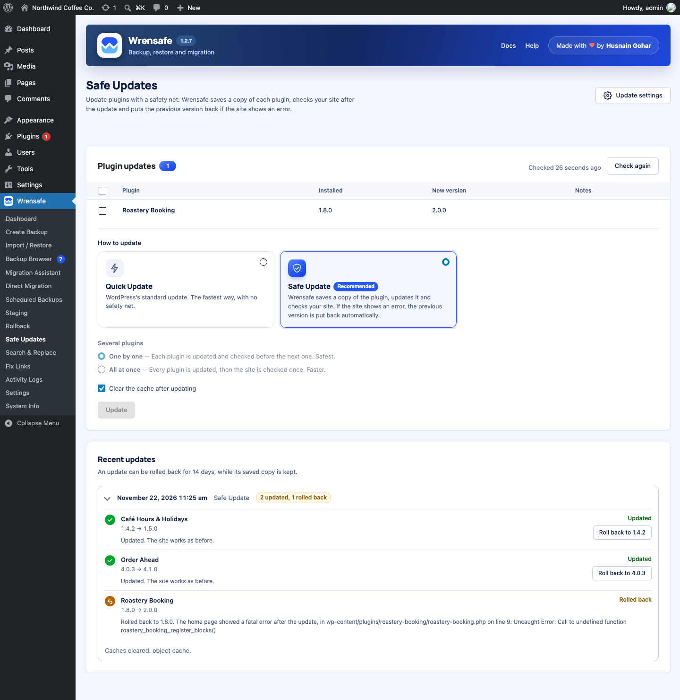 <b>Safe Updates</b>: update several plugins, follow the progress, roll back later.</td>
<td>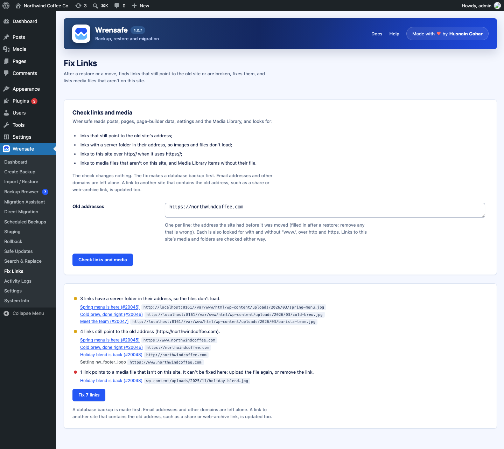 <b>Fix Links</b>: after a restore or a move, fix links that point to the old site or have a server folder in them, and see which media files are missing.</td>
</tr>
</table>

## Features

### Back up
- Full site, or only the database, files, media, themes or plugins.
- One `.wbp` file per backup, with a manifest and checksums.
- Optional AES-256 encryption per backup; the password is never stored.
- Notes and tags on backups.
- Automatic backups every day, week or month at a set time, keeping the newest copies, with a separate schedule for the database (for example daily, while the whole site is backed up weekly).
- **Off-site copies** to your own FTP/FTPS or S3-compatible storage right after each backup, sent in parts that resume, keeping the newest copies there. Passwords and keys are stored encrypted.
- Optional check of every backup right after it's made.
- A backup before WordPress, plugin and theme updates.
- No size limit: backups run in short steps, so they finish even where PHP stops scripts after 30 seconds. Interrupted uploads and downloads resume.
- Smart exclusions: other plugins' backup files and cache folders are skipped by default; add your own folders and file types, files above a size you set, and database tables you don't need.
- Choose where backups are kept, including a folder outside the website.
- `wp-config.php` and the site's security keys are never put in a backup.

### Restore safely
- Review before you restore: where the backup comes from, what's inside, what will change.
- Restore everything, or only the database, files, media, themes, plugins, or selected tables.
- Every file is checked first, and a rollback point is saved automatically so a restore can be undone.
- The database switches over in one step; visitors see a maintenance page meanwhile and you stay logged in.
- Plugin safety: a plugin that would break the restored site is turned off, and you're told which one and why.
- WooCommerce Safe Mode keeps new orders, customers and stock.
- Restore backups made by **All-in-One WP Migration, UpdraftPlus, Duplicator, WPvivid, BackWPup, Backup Migration, Total Upkeep, Solid Backups, WP Migrate and Jetpack VaultPress Backup**, or a plain `.sql` / `.zip` / `.tar`.

### Update safely
- When you update a plugin, choose **Quick Update** (WordPress's standard update) or **Safe Update**: Wrensafe saves a copy, updates, checks the home page and admin area, and puts the previous version back if the update causes a fatal error, a server error or an empty page. You can turn the question off.
- Update several plugins one by one or all at once, in the background; roll an update back later from the saved copy (kept 14 days by default).
- Optionally clear the page cache and object cache after updating.

### Migrate
- Move a site to a new domain or server; URLs and paths are rewritten safely, including serialized and page-builder data.
- Direct Migration: send a backup straight to another site with a one-time key.
- Migration Assistant: readiness score, server checks, recommended method and a checklist.
- Staging: a private copy with its own tables and keys, optional password protection that works on every web server, push to live.
- Search & Replace with a dry run, safe for serialized and JSON data.
- Fix Links: after a restore or a move, finds links that still point to the old site or have a server folder in them, fixes them after a database backup, and lists media files that aren't on the site.

### Stay informed
- Dashboard with protection status, backups, schedules and migration readiness.
- Activity Logs and a one-click debug bundle for support.
- Email when a backup or restore fails (and, if you like, when one succeeds), or when an off-site copy fails.
- Site Health checks: an out-of-date backup, backups kept only on the server, a backup folder that can be downloaded from the web.
- A Dashboard widget with the newest backup, the next scheduled one and a Back up now button.
- A security scan: core files checked against WordPress.org, PHP in uploads, hidden encoded code, unsafe permissions.
- Fully translatable, with right-to-left language support.

## Privacy

Backups stay on your server unless you set up off-site copies. Nothing is sent to Wrensafe, and there is no tracking. Data leaves your site only when an administrator sets up or starts one of these: off-site copies to the FTP/FTPS or S3-compatible server they choose, the core-file check (WordPress.org checksums API), Import from URL, Direct Migration to another site, or a plugin update (through WordPress's own updater and update check; the site check after an update only loads your own site).

## Found a problem?

[Open an issue](https://github.com/oyegohar/wrensafe-plugin/issues/new/choose). It helps a lot to attach the debug bundle from **Wrensafe → Activity Logs → Export debug bundle** (passwords and keys are never included).

## Licence

Wrensafe is free software under the [GNU General Public License v2 or later](LICENSE), the same licence as WordPress. Copyright © 2026 [Husnain Gohar](https://profiles.wordpress.org/oyegohar/).

The name **Wrensafe**, the logo and the artwork in `.wordpress-org/` identify this project. If you publish a modified version, please give it your own name and branding.
